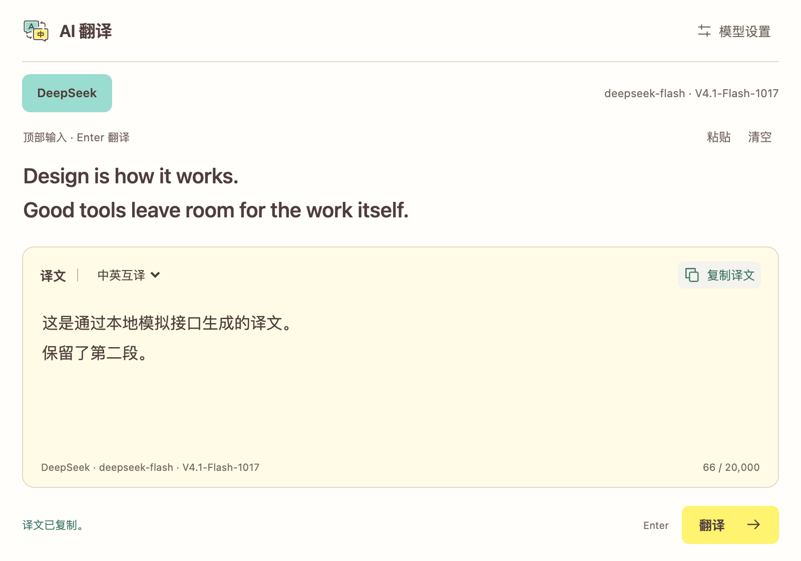
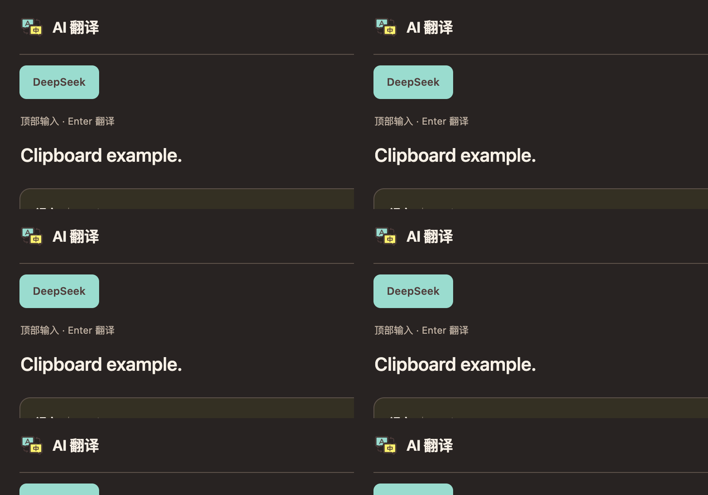

<p align="center">
  
</p>

<h1 align="center">AI 翻译</h1>

<p align="center">在 uTools 顶部输入，按 Enter 翻译。</p>

<p align="center">DeepSeek V4.1 Flash 1017 · 自定义模型 · 流式译文</p>

<p align="center">
  <a href="#快速开始">快速开始</a> ·
  <a href="#配置模型">配置模型</a> ·
  <a href="#触发关键词">触发关键词</a>
</p>



> 界面来自本地联调，译文为模拟数据。uTools 顶部输入框由宿主提供，未包含在这张预览中。

一个可本地安装的 uTools 翻译插件，使用自己的 API Key 直连模型平台。无需 npm、编译或上架应用市场。

- **输入即准备，回车才翻译。** 不会在打字时自动调用 API；修改原文会停止旧请求。
- **专注 DeepSeek。** 默认使用 `deepseek-flash`，当前由 DeepSeek‑V4.1‑Flash‑1017 提供服务。
- **边生成，边阅读。** 支持停止、复制，保留段落、列表和 Markdown 等原文结构。
- **中英互译，也支持指定语言。** 可选择简繁中文、英语、日语、韩语、法语、德语、西语和俄语。
- **中文词语自动展开词形。** 输入一个较短的中文词语并译为英语时，会同时列出常用的名词、动词和形容词形式。

<details>
<summary>查看深色界面</summary>



</details>

## 快速开始

需要安装 [uTools](https://www.u-tools.cn/)，并在其中安装「uTools 开发者工具」。插件使用 uTools 的加密存储 API，需使用支持 `dbCryptoStorage` 的版本。

**1. 获取源码**

```bash
git clone https://github.com/msunx/utools-translate.git
```

也可以从 GitHub 的 **Code → Download ZIP** 下载并解压。请将整个工程保存在固定位置。

**2. 接入 uTools**

在「uTools 开发者工具」中新建项目，进入「应用开发」，选择工程根目录的 `plugin.json`，点击「接入开发」，再点击「打开」。这一步不会发布到应用市场。

**3. 配置并翻译**

进入「模型设置」，填写 DeepSeek API Key，确认模型名称后保存。返回翻译页，在 uTools 顶部输入文本，按 **Enter** 或点击「翻译」。

以后在 uTools 搜索 **`tr`** 或 **`AI翻译`** 即可进入。也可以复制文本到 uTools 主搜索框，选择「AI翻译」带入原文。

## 配置模型

| 平台 | API 模型名 | 当前版本 | 获取 API Key |
| --- | --- | --- | --- |
| DeepSeek | `deepseek-flash` | DeepSeek‑V4.1‑Flash‑1017 | [DeepSeek 控制台](https://platform.deepseek.com/api_keys) |

DeepSeek 官方要求 API 请求继续使用模型名 `deepseek-flash`，该入口当前已升级为 DeepSeek‑V4.1‑Flash‑1017。模型名称仍可自由填写，但是否可用取决于账号权限。插件直连 DeepSeek 官方通用 API，不使用第三方中转。

API Key 输入框留空会保留已保存的密钥；填写新值可替换，勾选「移除密钥」后保存可删除。无需将密钥写入任何源码文件。

<details>
<summary>思考模式如何处理？</summary>

为减少翻译等待，`deepseek-flash` 会显式发送 `thinking: { "type": "disabled" }`。兼容模型名 `deepseek-v4-flash`、`deepseek-v4-pro` 和 `deepseek-chat` 也会关闭思考；其他自定义模型遵循平台默认行为。插件只展示译文，不展示或保存思考内容。

</details>

## 触发关键词

| 功能 | 默认关键词 |
| --- | --- |
| 打开翻译 | `AI翻译`、`tr`、`AI Translate` |
| 打开设置 | `AI翻译设置` |

只想按自己的习惯使用，可以在 uTools「所有指令」中找到「AI翻译」，点击指令旁的下拉菜单，选择「自定义别名」，例如 `fy`。

修改插件默认关键词时，编辑 `plugin.json` 中 `code: "translate"` 对应的 `cmds` 数组，增删其中的字符串。保留 `type: "over"` 的对象，它负责匹配待翻译文本。修改后重新接入开发。

## 使用细节

- **中英互译：** 原文主要为中文时译为英语，其他语言译为简体中文；也可固定目标语言。
- **中文词形：** 输入“授权”这类短中文词语并译为英语时，结果按名词、动词、形容词三行输出；没有自然、常用的对应形式时显示“无常用形式”。完整句子仍按普通方式翻译。
- **停止与重试：** 点击「停止」或按 Esc。修改原文会取消旧请求并清空旧译文，避免内容错位。
- **独立窗口：** 分离插件后会显示窗口内的原文输入框，使用 `⌘ Enter` / `Ctrl Enter` 翻译。
- **更新源码或图标：** 在开发者工具中结束当前开发运行，重新选择 `plugin.json` 并接入。仅刷新页面不一定会更新宿主登记的图标和指令。
- **本地安装：** 可通过开发者工具「打包」生成 `.upxs`，再离线安装自用。开发模式依赖工程目录，勿随意移动或删除。

## 数据与边界

API Key 和设置保存在 uTools 的 `dbCryptoStorage` 中，备份与同步遵循 uTools 自身设置。每次翻译会将原文和翻译要求直接发送给 DeepSeek，API 调用按 DeepSeek 账号规则计费。

插件不持久保存原文、译文或翻译历史；仍在后台运行的窗口可能保留本次内容。不自动切换供应商，也不自动重试失败的付费请求。

单次最多 **20,000 个字符**，请求最长 **3 分钟**。译文质量、模型权限和额度由平台决定。页面会提示密钥无效、限流、请求失败和输出截断等情况。

## 开发与验证

项目由原生 HTML、CSS、JavaScript 构成，无构建步骤。

| 文件 | 职责 |
| --- | --- |
| `plugin.json` | uTools 入口、图标和功能指令 |
| `index.html` / `style.css` / `app.js` | 界面与交互 |
| `preload.js` | 加密存储、剪贴板、宿主输入框与生命周期 |
| `client.js` | HTTPS 请求、流式解析、超时和取消 |
| `shared.js` | 平台、模型建议与语言配置 |

在浏览器直接打开 `index.html` 可预览界面；保存密钥及调用翻译需在 uTools 中运行。

当前已通过本地模拟接口与浏览器联调，覆盖 UTF-8 流式输出、错误、取消、DeepSeek 配置、顶部输入同步及深浅主题。尚未使用真实 API Key 完成端到端翻译验证。临时联调文件、截图原稿、证书和开发备份不纳入仓库。

[uTools 开发文档](https://www.u-tools.cn/docs/developer/basic/first-plugin.html) · [DeepSeek API 文档](https://api-docs.deepseek.com/zh-cn/) · [DeepSeek 模型与价格](https://api-docs.deepseek.com/quick_start/pricing/)
